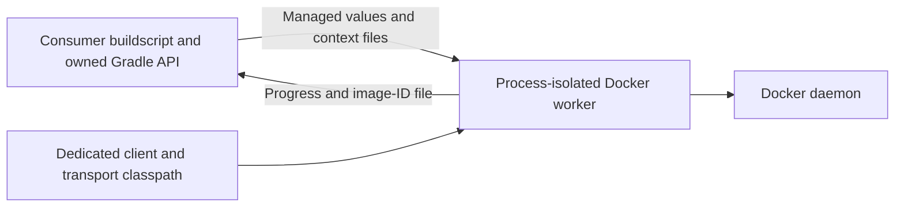

# Ospackage-owned Docker API and process isolation

Status: implemented for review as a major-release change. See the
[Docker guide](../docs/docker-process-isolation.md) for configuration and migration.

## Problem and decision

Ospackage's bmuschko runtime dependency embeds Docker API classes under their
original names but relocates their Jackson annotations. A child buildscript can
inherit these models from its parent and deserialize responses with missing
fields because its own mapper does not recognize the relocated annotations.
This also affects builds that only use RPM/DEB packaging.

Provide an ospackage-owned image-building API backed by a process-isolated
Gradle worker. Remove bmuschko from the published runtime graph. Compile the
worker against docker-java with `compileOnly`, and resolve its client and
transport exclusively through a dedicated worker configuration.

This is a deliberate major-release API change. Move ospackage image settings from
`docker {}` to `ospackageDocker {}` and change imports to the owned types. Do not
advertise this implementation as a compatible patch release.

## Public API

The explicit `com.netflix.nebula.ospackage-docker` plugin supplies:

| Surface | Owned API |
| --- | --- |
| `ospackageDocker {}` | `com.netflix.gradle.plugins.docker.DockerExtension` |
| `registryCredentials {}` | `com.netflix.gradle.plugins.docker.DockerRegistryCredentials` |
| `createDockerfile` | Existing `SystemPackageDockerfile` task |
| `buildImage` | `com.netflix.gradle.plugins.docker.DockerBuildImage` |
| `buildDocker` | Lifecycle task depending on `buildImage` |

`DockerBuildImage` exposes managed values, rather than Docker client or model
objects:

- Context: `inputDir`, optional `dockerFile`.
- Image/build configuration: `images`, `buildArgs`, `labels`, `target`, `platform`,
  `network`, `extraHosts`, `cacheFrom`, `memory`, `shmSize`.
- Build flags: `noCache`, `pull`, `remove`, `quiet`.
- Connection: `url`, `apiVersion`, `tlsVerify`, `certPath`, `registryCredentials`.
- Result: `imageIdFile` and a derived read-only `imageId` provider.
- Runtime override: `workerClasspath`, normally supplied by the plugin.

All image tasks of the owned type inherit the worker classpath, connection and
registry conventions. Explicit task values override conventions. The default
`buildImage` depends on `createDockerfile` and derives its input directory from
that task's `destinationDirectory`. Custom tasks supply their own context and
dependency wiring.

Collections default to empty; optional Docker flags remain unset. Unset
connection settings follow the client's supported environment/configuration
defaults. The plugin does not require the Docker CLI or add repositories.

## Process and dependency boundary

`ospackageDockerWorkerDependencies` is a dependency-declaration configuration.
`ospackageDockerWorkerClasspath` is resolvable only and extends it. Neither
extends plugin, application or buildscript configurations. Defaults use
docker-java core and HTTP client 5 transport, version 3.7.1, maintained in one
resource used for compilation and runtime defaults. Explicit declarations on
the dependency configuration replace the default dependency set and must supply
a complete, compatible runtime.

Wire the classpath through the task's `@Classpath` file collection using a
configuration lookup provider. Do not resolve it in plugin application or task
registration. `help`, `createDockerfile`, RPM and DEB tasks must work without
resolving worker dependencies.

The worker constructs the client, builds the image, closes its resources, emits
progress and writes the image ID after success. Docker types must not appear in
daemon-facing task/extension signatures or managed worker parameters. Neither
the plugin JAR, published POM nor Gradle Module Metadata may introduce bmuschko
or Docker client runtime dependencies.

Process isolation is a JVM/classloading boundary, not a security sandbox. Gradle
may reuse compatible worker JVMs. Consumer dependency policies still apply to
worker resolution. Loading another plugin's bundled Docker classes independently
can still cause conflicts outside this boundary.

## Build context, results and failures

Keep Dockerfile generation in ospackage. Copy filtered context files into a
task-owned `.ospackage` directory, preserving distinct destination paths. Emit
JSON-array `ADD` instructions to handle spaces. Track the directory as an output,
clear stale staged files and reject traversal beyond the staging directory.

Image building changes external Docker daemon state, so disable build caching
and up-to-date skipping. The image-ID file alone cannot establish that a tag or
image still exists. Delete the previous result before submitting work and write
a new result only after a successful build. A failure during configuration or
input resolution can precede that deletion; downstream tasks must depend on
successful completion, rather than reading a leftover file independently.

Tasks and workers must not access `Project` from execution actions. Configuration
cache reuse must work while requested image builds still execute every time.

Redact configured registry credentials and client-discovered authentication
values from worker progress and failures. Do not persist them in the image-ID
file. Credentials still cross Gradle's managed state boundary and can be stored
by its configuration cache; process isolation does not prevent that persistence.
Arbitrary Dockerfile output and build arguments are not a secret-storage API.

## Migration and coexistence

Keep the existing plugin IDs, task names and familiar basic property syntax.
Rename the connection/credentials block to `ospackageDocker` and change
imports/type lookups to ospackage-owned classes. The following behaviors
are intentionally removed from this integration:

- Automatic bmuschko plugin application and its transitive availability.
- Base-plugin task activation triggered by applying bmuschko.
- Direct `dockerClient` access and typed Docker model callbacks, including
  `onNext`, `onError` and `onComplete`.
- bmuschko task subclassing and unrelated container, push and tag task APIs.

Use task dependencies, progress output and the image-ID result for the owned
image-building API. Existing bmuschko users can instead explicitly declare its
dependency and retain their own tasks. Ordinary ospackage packaging supports
that combination in either application order. It retains any classpath exposure
introduced independently by bmuschko.

The explicit ospackage Docker integration defines `ospackageDocker`, leaving
`docker` available for bmuschko. Both can share a project in either application
order, with separate connection and credential settings. Their image tasks keep
their own types and defaults. Consumers must still avoid duplicate task names.

## Alternatives considered

- Keep bmuschko and only move execution: leaves its bundled models on the plugin
  classpath and does not fix the reported failure.
- Correct upstream packaging: could preserve bmuschko's public APIs, but needs a
  suitable upstream release or a maintained packaging patch. Exclusions cannot
  remove embedded classes from its currently published shaded runtime variant.
- Relocate public Docker types: changes public method descriptors and does not
  preserve the existing API contract.
- Docker CLI: isolates execution but adds an executable requirement and different
  configuration behavior.
- Classloader isolation: provides a weaker process-state boundary than the
  selected worker process.

## Acceptance and validation

1. Owned DSL/type lookups and custom image tasks work; task names, context wiring,
   credentials and supported basic build options are exercised.
2. An actual built JAR resolved through plugin markers and publication metadata
   leaves root-buildscript Docker API classes absent. Testcontainers 2.0.4 in a
   child buildscript parses `OSType` and `MemTotal` correctly. A control fixture
   with the old bundled client reproduces the annotation mismatch.
3. Inspect both main publications' POM and module metadata and the built JAR for
   leaked client dependencies/classes. TestKit's injected development classpath
   alone is insufficient for this regression.
4. Controlled HTTP/TLS fixtures verify worker/daemon PID separation, class origins,
   options, authentication, failure redaction and stale-result removal. An older
   consumer Docker/Jackson stack must not replace the worker's configured client.
5. Verify lazy dependency resolution for ordinary tasks, independent bmuschko
   coexistence with packaging and owned image builds in both orders, separate
   connection/credential defaults, and configuration-cache reuse on supported
   Gradle versions.
6. In an opted-in Docker lane, build, inspect and remove a test-owned scratch
   image from the generated context. Run the existing packaging suite and plugin
   validation. An environment skip is not evidence of a successful live build.

Windows named pipes, live-build cancellation and the remaining supported JDK
matrix require validation before release. Verification results must describe the
owned implementation, rather than treating previous prototype results as proof.

The full build on JDK 21 passed with 402 tests, zero failures/errors and 28 skips,
including plugin validation and the opted-in live Docker test. This includes
same-project bmuschko coexistence in both application orders, separate connection
and credential settings, HTTP/TLS fixtures, published-artifact regressions and
configuration-cache reuse on Gradle 8.6, 9.5.1 and 9.8.2.

## Public documentation boundary

Use only general technical details and public reproductions in repository files,
commits, issues and PRs. Private incident links, usage inventories, tracking keys,
consumer identities and infrastructure details stay in internal tracking.
